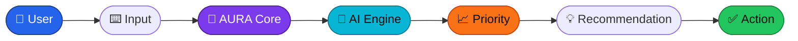
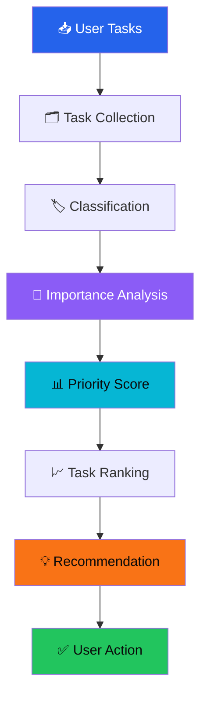
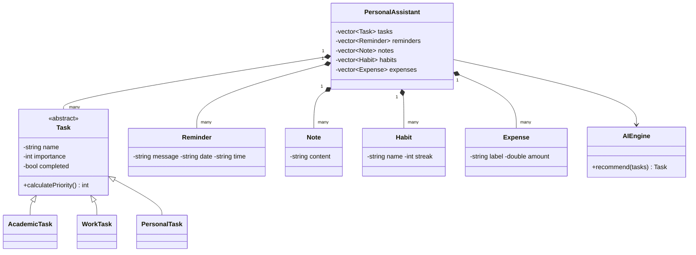

<div align="center">


<br/>


<br/>


<svg viewBox="0 0 1000 24" xmlns="http://www.w3.org/2000/svg">
  <defs>
    <linearGradient id="lineGrad" x1="0%" y1="0%" x2="100%" y2="0%">
      <stop offset="0%" stop-color="#0f172a"/>
      <stop offset="50%" stop-color="#2563eb"/>
      <stop offset="100%" stop-color="#0f172a"/>
    </linearGradient>
    <radialGradient id="dotGlow" cx="50%" cy="50%" r="50%">
      <stop offset="0%" stop-color="#ffffff"/>
      <stop offset="35%" stop-color="#22d3ee"/>
      <stop offset="100%" stop-color="#22d3ee" stop-opacity="0"/>
    </radialGradient>
  </defs>

  <rect x="0" y="10" width="1000" height="3" fill="url(#lineGrad)"/>

  <circle r="9" fill="url(#dotGlow)">
    <animateMotion dur="3.2s" repeatCount="indefinite" path="M0,12 L1000,12"/>
  </circle>
  <circle r="4" fill="#ffffff">
    <animateMotion dur="3.2s" repeatCount="indefinite" path="M0,12 L1000,12"/>
    <animate attributeName="opacity" values="0.3;1;0.3" dur="0.6s" repeatCount="indefinite"/>
  </circle>

  <circle r="7" fill="url(#dotGlow)" opacity="0.7">
    <animateMotion dur="3.2s" begin="-1.6s" repeatCount="indefinite" path="M1000,12 L0,12"/>
  </circle>
  <circle r="3" fill="#a78bfa">
    <animateMotion dur="3.2s" begin="-1.6s" repeatCount="indefinite" path="M1000,12 L0,12"/>
  </circle>
</svg>

<br/>


<br/><br/>

<a href="#-overview">Overview</a> ·
<a href="#-why-aura">Why AURA</a> ·
<a href="#-feature-showcase">Features</a> ·
<a href="#-the-ai-engine">AI Engine</a> ·
<a href="#-oop-architecture">Architecture</a> ·
<a href="#-how-aura-works">Workflow</a> ·
<a href="#-terminal-demo">Demo</a> ·
<a href="#-installation">Install</a> ·
<a href="#-usage-guide">Usage</a> ·
<a href="#-development-roadmap">Roadmap</a> ·
<a href="#-future-vision">Vision</a> ·
<a href="#-contributing">Contributing</a>

</div>


## ✨ Overview

**AI Powered Personal Assistant** — codename **AURA**, short for *Adaptive User Response Assistant* — is a productivity system built entirely in Object-Oriented C++. Instead of just storing your tasks, reminders, habits, notes, and expenses, AURA actively analyzes them and tells you what to focus on next.

<table>
<tr>
<td width="62%" valign="top">

It's built around one idea: a productivity tool should *think*, even a little. AURA does this with a rule-based priority engine — every task is scored on importance and category, ranked, and surfaced as a recommendation, automatically.


</td>
<td width="38%" align="center">


</td>
</tr>
</table>



> **Note on "AI":** AURA's current engine uses deterministic, OOP-based decision logic — not an external LLM. That distinction matters, and it's called out explicitly wherever it's relevant. External LLM integration is a planned future extension — see [Future Vision](#-future-vision).

<br/>

## ⚖️ Why AURA?

A typical task manager is passive — it stores what you type and shows it back to you. AURA is built to be active.

<table>
<tr>
<th align="left">🗃️ Traditional Task Manager</th>
<th align="left">🤖 AURA</th>
</tr>
<tr>
<td valign="top">

- Stores tasks as flat records
- Displays them in the order added
- Leaves prioritization entirely to the user
- No feedback on productivity or consistency

</td>
<td valign="top">

- 🧠 Scores every task by importance + category
- 📈 Ranks tasks and surfaces the top priority
- ⚡ Recommends what to work on, automatically
- 🔥 Tracks habit streaks and spending over time

</td>
</tr>
</table>


## 🧩 Feature Showcase

<table>
<tr>
<td width="25%" valign="top">


Analyzes every pending task and recommends the one to tackle first.

</td>
<td width="25%" valign="top">


Academic, work, and personal categories — each with its own priority weighting.

</td>
<td width="25%" valign="top">


Message, date, and time — created and reviewed from the same menu.

</td>
<td width="25%" valign="top">


Structured personal notes that persist across sessions.

</td>
</tr>
<tr>
<td width="25%" valign="top">


Daily completion tracking with streak counts.

</td>
<td width="25%" valign="top">


Log spending and see running totals.

</td>
<td width="25%" valign="top">


Completed vs. pending counts and a productivity percentage.

</td>
<td width="25%" valign="top">


Everything is saved to disk and reloaded on the next run.

</td>
</tr>
</table>


## 🧠 The AI Engine



**How the score is calculated:**

```
Priority Score = Importance + Category Weight

🎓 Academic Task  →  Importance + 20
💼 Work Task      →  Importance + 15
🏠 Personal Task  →  Importance +  0
```

A higher score means a higher recommendation priority. Here's the engine working on a real example:

```text
╭──────────────────────────────────────╮
│ 🤖 AURA — Priority Calculation        │
├──────────────────────────────────────┤
│ Task:            DAA Assignment      │
│ Category:        🎓 Academic          │
│ Importance:       80                 │
│ Category Bonus:  +20                 │
│ Final Priority:   100  🔥🔥🔥         │
│                                       │
│ Recommendation → Work on this first. │
╰──────────────────────────────────────╯
```


## 🏛️ OOP Architecture

```
PersonalAssistant
│
├── 🧠 AIEngine
│
├── 📋 Task (base class)
│   ├── 🎓 AcademicTask
│   ├── 💼 WorkTask
│   └── 🏠 PersonalTask
│
├── ⏰ Reminder
├── 📝 Note
├── 🔥 Habit
└── 💰 Expense
```

<table>
<tr><th align="left">Class</th><th align="left">Responsibility</th></tr>
<tr><td><code>PersonalAssistant</code></td><td>Central orchestrator — composes and manages every other component</td></tr>
<tr><td><code>Task</code></td><td>Base representation of a unit of work</td></tr>
<tr><td><code>AcademicTask / WorkTask / PersonalTask</code></td><td>Category-specific subclasses, each with its own priority weighting</td></tr>
<tr><td><code>AIEngine</code></td><td>Applies the priority algorithm and generates recommendations</td></tr>
<tr><td><code>Reminder</code></td><td>Encapsulates a scheduled message with a date and time</td></tr>
<tr><td><code>Note</code></td><td>Encapsulates structured free-text notes</td></tr>
<tr><td><code>Habit</code></td><td>Tracks daily completion and streak consistency</td></tr>
<tr><td><code>Expense</code></td><td>Tracks individual spending entries and totals</td></tr>
</table>

**Class relationships:**



**OOP concepts actually implemented in the codebase:**


<table>
<tr><td>🔒 <b>Encapsulation</b> — private task/user data</td><td>🧬 <b>Inheritance</b> — Academic/Work/Personal tasks</td></tr>
<tr><td>🎭 <b>Polymorphism</b> — virtual task behavior</td><td>🧩 <b>Abstraction</b> — AIEngine's simple interface</td></tr>
<tr><td>🧱 <b>Composition</b> — PersonalAssistant owns components</td><td>🏗️ <b>Constructors/Destructors</b> — init & cleanup</td></tr>
<tr><td>💾 <b>Dynamic Memory</b> — <code>new</code>/<code>delete</code></td><td>📚 <b>STL</b> — <code>vector</code> + algorithms</td></tr>
<tr><td>⚠️ <b>Exception Handling</b> — input/error handling</td><td>💽 <b>File Handling</b> — persistent storage</td></tr>
</table>

<sub>Only concepts genuinely present in the code are listed as implemented — anything else is tracked in the <a href="#-development-roadmap">Roadmap</a> instead of being claimed here.</sub>


## 🔄 How AURA Works

<table>
<tr><td align="center"><b>01</b></td><td>📥 <b>User Input</b></td><td>User selects a menu option and provides data</td></tr>
<tr><td align="center"><b>02</b></td><td>⚙️ <b>Command Processing</b></td><td>Input is routed to the correct handler</td></tr>
<tr><td align="center"><b>03</b></td><td>🗂️ <b>Data Management</b></td><td>Entities are stored in memory using STL containers</td></tr>
<tr><td align="center"><b>04</b></td><td>🧠 <b>AI Analysis</b></td><td><code>AIEngine</code> inspects all pending tasks</td></tr>
<tr><td align="center"><b>05</b></td><td>📊 <b>Priority Calculation</b></td><td>Importance + category weight is computed per task</td></tr>
<tr><td align="center"><b>06</b></td><td>💡 <b>Recommendation</b></td><td>The highest-priority task is surfaced to the user</td></tr>
<tr><td align="center"><b>07</b></td><td>📈 <b>Productivity Tracking</b></td><td>Completion stats and habit streaks are updated</td></tr>
<tr><td align="center"><b>08</b></td><td>💾 <b>Data Persistence</b></td><td>State is written to disk for the next session</td></tr>
</table>

### Walking through an example

**Input:** *"I have a DAA assignment due tomorrow."*

```text
╭──────────────────────────────────────╮
│ 🤖 AURA                               │
├──────────────────────────────────────┤
│ Task detected:  DAA Assignment        │
│ Category:       🎓 Academic            │
│ Importance:     80                    │
│ Priority:       100 🔥                │
│                                        │
│ Recommendation → Complete this first. │
╰──────────────────────────────────────╯
```


## 🖥️ Terminal Demo

```text
$ ./aura

╔══════════════════════════════════════╗
║              A U R A                  ║
║       AI PERSONAL ASSISTANT           ║
╚══════════════════════════════════════╝

 1. Add Task            9. View Habits
 2. View Tasks         10. Complete Habit
 3. Complete Task      11. Add Expense
 4. Add Reminder       12. View Expenses
 5. View Reminders     13. Ask AURA AI
 6. Add Note           14. Productivity Analysis
 7. View Notes         15. Save Data
 8. Add Habit           0. Exit

Enter choice: _
```

<sub>🎬 Record a real terminal session and save it as <code>assets/aura-demo.gif</code> to replace this static block — see <a href="#-project-showcase">Project Showcase</a>.</sub>

### Productivity Dashboard *(conceptual mockup — not yet implemented)*

```
╔══════════════════════════════════════════╗
║              AURA DASHBOARD               ║
╠══════════════════════════════════════════╣
║ ✅ Tasks Completed        7                ║
║ ⏳ Tasks Pending          2                ║
║ 📈 Productivity           84%              ║
║ 🔥 Habit Streak           12 days          ║
║ 💰 Monthly Expenses       ₹8,420           ║
╚══════════════════════════════════════════╝
```


## 📁 Project Structure

<table>
<tr>
<th align="left">📌 Current</th>
<th align="left">🚀 Recommended Future</th>
</tr>
<tr valign="top">
<td>

```
AURA/
├── main.cpp
├── data/
│   └── aura_data.txt
└── README.md
```

</td>
<td>

```
AURA/
├── src/
│   ├── main.cpp
│   ├── Task.cpp
│   ├── AIEngine.cpp
│   ├── Reminder.cpp
│   ├── Habit.cpp
│   ├── Note.cpp
│   └── Expense.cpp
├── include/
│   └── *.h
├── data/
│   └── aura_data.txt
├── assets/
│   ├── aura-robot.svg
│   ├── aura-glow-divider.svg
│   ├── aura-skills.svg
│   └── aura-demo.gif
├── README.md
└── LICENSE
```

</td>
</tr>
</table>

## 🛠️ Technology Stack

<div align="center">

**✅ Currently used**


<br/>


**🔮 Planned, not yet implemented**


</div>


## ⚙️ Installation

**1. Clone the repository**

```bash
git clone <YOUR_REPOSITORY_URL>
cd AURA
```

**2. Compile**

```bash
# Single-file build (current structure)
g++ main.cpp -o aura

# Multi-file build (if using the recommended future structure)
g++ src/*.cpp -Iinclude -o aura
```

**3. Run**

```bash
./aura        # Linux / macOS
aura.exe      # Windows
```

## 📖 Usage Guide

<details>
<summary>📋 <b>Task Management</b></summary>
<br/>
Add academic, work, or personal tasks with an importance score and deadline. Mark tasks complete from the menu — AURA computes each task's priority automatically.
</details>

<details>
<summary>⏰ <b>Reminders</b></summary>
<br/>
Add a reminder with a message, date, and time. View all active reminders from the menu.
</details>

<details>
<summary>📝 <b>Notes</b></summary>
<br/>
Create structured personal notes and view them at any time.
</details>

<details>
<summary>🔥 <b>Habits</b></summary>
<br/>
Add a habit, mark it complete for the day, and watch your streak grow.
</details>

<details>
<summary>💰 <b>Expenses</b></summary>
<br/>
Log an expense with a label and amount. View total spending at any time.
</details>

<details>
<summary>🧠 <b>AI Recommendations</b></summary>
<br/>
Ask AURA which task to work on next — the priority engine ranks pending tasks and returns the top pick.
</details>

<details>
<summary>📊 <b>Productivity Analysis</b></summary>
<br/>
View total tasks, completed tasks, pending tasks, and your overall productivity percentage.
</details>

<details>
<summary>💾 <b>Saving Data</b></summary>
<br/>
Save the current session's data to disk so it's available the next time AURA runs.
</details>


## 🎥 Project Showcase

Assets referenced throughout this README that don't exist yet — capture and add them to `assets/`:

<table>
<tr><th align="left">File</th><th align="left">What to capture</th></tr>
<tr><td><code>assets/aura-robot.svg</code></td><td>✅ Included — animated mascot used at the top of this README</td></tr>
<tr><td><code>assets/aura-glow-divider.svg</code></td><td>✅ Included — animated section-divider used throughout</td></tr>
<tr><td><code>assets/aura-skills.svg</code></td><td>✅ Included — animated OOP concept meter</td></tr>
<tr><td><code>assets/aura-demo.gif</code></td><td>Full session recording (add a task → get a recommendation)</td></tr>
<tr><td><code>assets/aura-dashboard.png</code></td><td>Screenshot of the productivity summary output</td></tr>
<tr><td><code>assets/aura-architecture.svg</code></td><td>Exported architecture diagram, if you build one outside Mermaid</td></tr>
</table>

## 🗺️ Development Roadmap

<table>
<tr><td valign="top">

**✅ Phase 1 — Core OOP**
- [x] Task management
- [x] Task inheritance
- [x] Rule-based AI recommendation engine
- [x] Reminder system
- [x] Notes
- [x] Habit tracking
- [x] Expense tracking
- [x] Productivity analysis
- [x] File persistence

</td><td valign="top">

**🚧 Phase 2 — Intelligence**
- [ ] Natural language command parser
- [ ] Advanced priority algorithm
- [ ] Smart scheduling
- [ ] Deeper personalized recommendations

</td></tr>
<tr><td valign="top">

**🔮 Phase 3 — AI**
- [ ] LLM integration
- [ ] Context-aware assistant
- [ ] Conversational memory
- [ ] AI-generated planning

</td><td valign="top">

**🚀 Phase 4 — Platform**
- [ ] GUI
- [ ] SQLite persistence
- [ ] Voice assistant
- [ ] Mobile / web interface
- [ ] Cloud synchronization

</td></tr>
</table>


## 🚀 Future Vision

<div align="center">

> **A complete intelligent personal operating system.**


<sub>Everything above is a future idea, not a current feature.</sub>

</div>

## 🛡️ Security & Privacy

- 🔒 Data is stored **locally** via file handling — nothing leaves the machine today.
- 🚫 No external data sharing exists in the current implementation.
- 🔮 **Planned:** encryption at rest, authentication, and secure API-key handling via environment variables once external integrations are added.

## ⚡ Performance

<table>
<tr><th align="left">Operation</th><th align="left">Complexity</th></tr>
<tr><td>Task recommendation (priority sort)</td><td><code>O(n log n)</code></td></tr>
<tr><td>Task traversal / listing</td><td><code>O(n)</code></td></tr>
<tr><td>Habit streak update</td><td><code>O(1)</code> per habit</td></tr>
<tr><td>Expense total calculation</td><td><code>O(n)</code></td></tr>
</table>


## 🎓 Learning Outcomes

This project demonstrates:


## 🤝 Contributing

1. 🍴 Fork the repository
2. 🌿 Create a feature branch
3. ✏️ Make your changes
4. ✅ Test thoroughly
5. 💾 Commit your changes
6. 📤 Push to your branch
7. 🔁 Open a pull request

## 📄 License

Distributed under the **MIT License**. *(Replace this section if the repository already has a different license.)*


<div align="center">

## 👨‍💻 Author

**Ranjan Kumar Nandi**
🆔 `B125095`
📁 Project: AI Powered Personal Assistant (AURA)

-181717?style=flat-square&logo=github&logoColor=white"/>
-0A66C2?style=flat-square&logo=linkedin&logoColor=white"/>
-EA4335?style=flat-square&logo=gmail&logoColor=white"/>

<br/>

⭐ **If this project sparked an idea, consider starring the repository.**


</div> 
