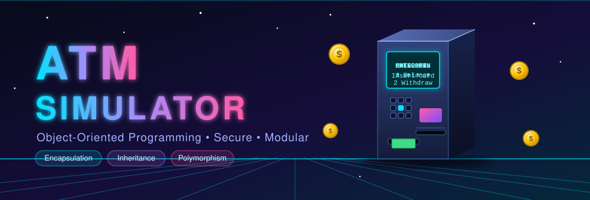
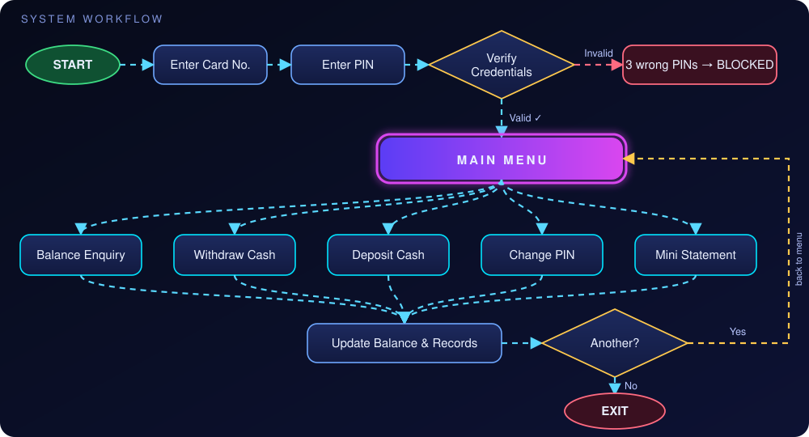
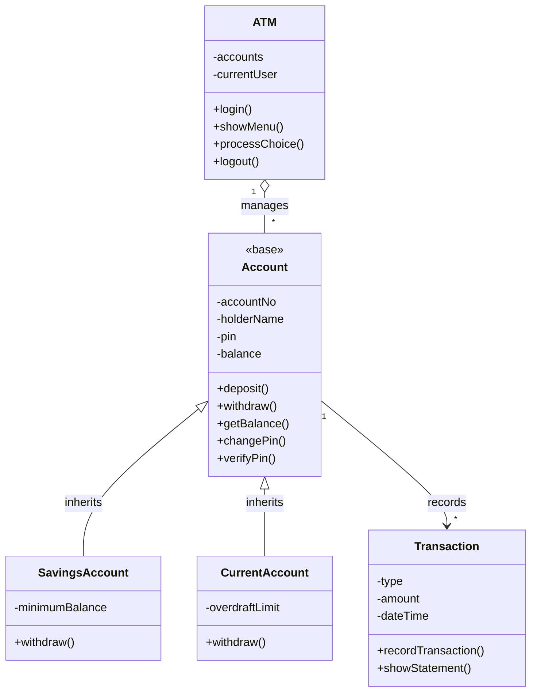
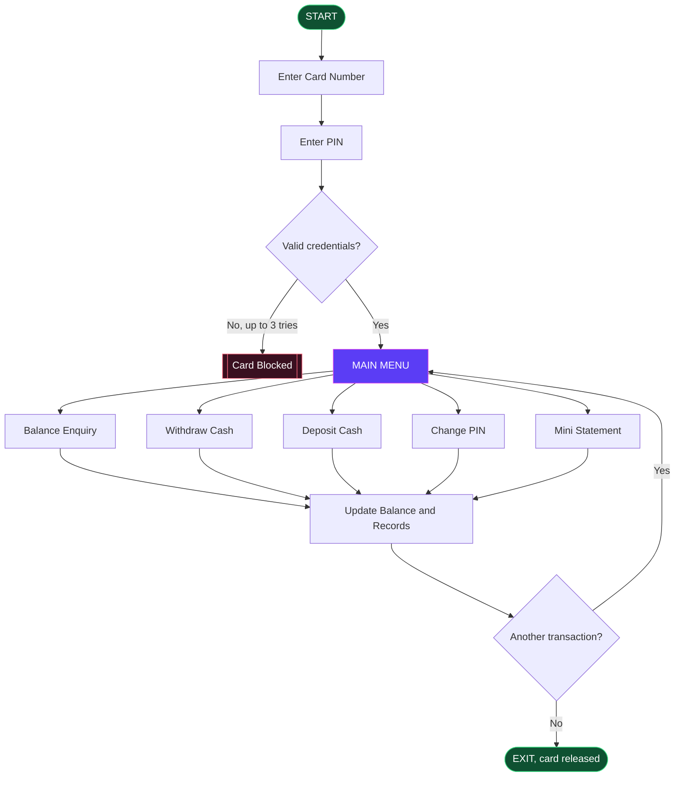

<div align="center">
<p align="center">
  
</p>

<div align="center">
  <table>
    <tr>
      <td align="center" width="60%">
        
      </td>
      <td align="center" width="55%">
        
      </td>
    </tr>
  </table>
</div>


<a href="https://git.io/typing-svg">
  
</a>

<br/>


**[Abstract](#-abstract) · [Features](#-features) · [OOP Concepts](#-oop-concepts-used) · [Class Design](#-class-design) · [Workflow](#-workflow) · [Run It](#-getting-started) · [Future Scope](#-future-scope)**

</div>

## 🔄 Workflow

<p align="center">
  
</p>

---

## ✨ Abstract

> An **Automated Teller Machine (ATM)** lets customers do basic banking without visiting a branch. The **ATM Simulator** is a software application built on **Object-Oriented Programming** that imitates a real ATM in a safe, virtual environment.

A user inserts a card number, authenticates with a secret PIN, and then performs operations such as **checking balance, withdrawing cash, depositing cash, changing the PIN, and viewing a mini statement**. Every action is validated, so invalid PINs, insufficient balance, and wrong inputs are handled with clear messages.

The project is designed around core OOP concepts: **classes and objects, encapsulation, abstraction, inheritance, polymorphism, constructors, and exception handling**. Account data such as balance and PIN stays private and is reachable only through controlled methods, which keeps the system secure, modular, reusable, and easy to maintain.

**🎓 Purpose:** apply OOP theory to a real-life banking scenario and understand how a simple, reliable transaction system is built.

`ATM` · `Simulator` · `OOPs` · `Encapsulation` · `Inheritance` · `Polymorphism` · `Banking` · `Transaction`

---

## 🎯 Objectives

| | Objective |
|:-:|---|
| 🏗️ | Design a working model of an ATM using OOP concepts |
| 🔐 | Provide secure, PIN-based user authentication |
| 💸 | Perform core banking operations: withdraw, deposit, balance enquiry, PIN change |
| 🛡️ | Protect sensitive data using encapsulation |
| 🚦 | Handle errors and invalid inputs gracefully |
| 🧩 | Build a modular program that can be easily extended |

## ❓ Problem Statement

Students often learn OOP only as theory. There is a need for a practical project that shows how **classes, objects, and their relationships** work together in a real system. The ATM Simulator solves this by modelling a familiar banking device, **without any real bank hardware or real money at risk**.

---

## 🎬 Demo

> Illustrative console session. Your actual output may look different.

```text
┌──────────────────────────────────────────┐
│              ATM SIMULATOR               │
├──────────────────────────────────────────┤
│  Enter Card Number : 1001                │
│  Enter PIN         : ****                │
│  Login successful                        │
├──────────────────────────────────────────┤
│  1. Balance Enquiry    2. Withdraw Cash  │
│  3. Deposit Cash       4. Change PIN     │
│  5. Mini Statement     6. Exit           │
└──────────────────────────────────────────┘
```

---

## 🚀 Features

| # | Feature | What it does |
|:-:|---|---|
| 1 | 🔑 **Card and PIN Login** | Verifies card number and PIN before access |
| 2 | 💼 **Balance Enquiry** | Shows the current account balance |
| 3 | 💸 **Cash Withdrawal** | Deducts the amount after checking the available balance |
| 4 | 🏦 **Cash Deposit** | Adds the entered amount to the account |
| 5 | 🔄 **PIN Change** | Lets the user set a new PIN securely |
| 6 | 🧾 **Mini Statement** | Displays the recent transactions |
| 7 | ✅ **Input Validation** | Rejects wrong PINs, negative amounts, and invalid choices |
| 8 | 🔒 **Account Lock** | Blocks the card after 3 wrong PIN attempts |
| 9 | 🚪 **Exit** | Ends the session safely |

---

## 🧠 OOP Concepts Used

| Concept | How it is used in the project |
|---|---|
| 🧱 **Class and Object** | `Account`, `Customer`, `ATM`, `Transaction` are classes; each customer or account is an object |
| 🔐 **Encapsulation** | Balance and PIN are **private** data members, accessed only through public methods |
| 🎭 **Abstraction** | The user sees simple options (withdraw, deposit) while the internal logic stays hidden |
| 🧬 **Inheritance** | `SavingsAccount` and `CurrentAccount` inherit from the base class `Account` |
| 🌀 **Polymorphism** | `withdraw()` behaves differently for each account type (overriding) |
| 🏗️ **Constructor** | Initialises account number, name, PIN, and opening balance |
| 🚨 **Exception Handling** | Handles insufficient funds, invalid PIN, and wrong input |

---

## 🏗️ Class Design



<details>
<summary><b>📋 Class table (click to expand)</b></summary>

| Class | Main Data Members | Main Methods |
|---|---|---|
| **Account** (base) | `accountNo`, `holderName`, `pin` (private), `balance` (private) | `deposit()`, `withdraw()`, `getBalance()`, `changePin()`, `verifyPin()` |
| **SavingsAccount** | `minimumBalance` | `withdraw()` (overridden) |
| **CurrentAccount** | `overdraftLimit` | `withdraw()` (overridden) |
| **Transaction** | `type`, `amount`, date and time | `recordTransaction()`, `showStatement()` |
| **ATM** | list of accounts, current user | `login()`, `showMenu()`, `processChoice()`, `logout()` |

</details>

---


<details>
<summary><b>🧭 Same flow as an interactive Mermaid chart (click to expand)</b></summary>



</details>

### 📖 Step-by-step

| Step | Process | Description |
|:-:|---|---|
| **1** | START | The ATM program starts and shows a welcome screen |
| **2** | Enter Card Number | The user enters the account or card number |
| **3** | Enter PIN | The user enters the 4-digit PIN |
| **4** | Verify Credentials | The system checks the card number and PIN |
| **5** | Valid? | **No** → show an error, allow retry (maximum 3 attempts, then block the card). **Yes** → go to the main menu |
| **6** | Main Menu | Balance, Withdraw, Deposit, Change PIN, Mini Statement, Exit |
| **7** | Perform Selected Operation | Execute the chosen option |
| **8** | Update Records | Update the balance and save the transaction |
| **9** | Another Transaction? | **Yes** → return to the Main Menu. **No** → continue to Exit |
| **10** | Exit and END | Card is released and the session ends |

<details>
<summary><b>🛠️ Operation-wise workflow (click to expand)</b></summary>

**💸 Withdraw Cash**
1. Enter the amount to withdraw.
2. Check that the amount is positive and valid.
3. Check that the balance is sufficient.
4. If sufficient, deduct the amount, record the transaction, and show the new balance.
5. If not, show "Insufficient Balance".

**🏦 Deposit Cash**
1. Enter the amount to deposit.
2. Check that the amount is greater than zero.
3. Add the amount to the balance and record the transaction.
4. Show the updated balance.

**💼 Balance Enquiry**
1. Fetch the balance from the account object.
2. Display it on the screen.

**🔄 Change PIN**
1. Enter the old PIN and verify it.
2. Enter the new PIN twice.
3. If both match, update the PIN and confirm.

**🧾 Mini Statement**
1. Read the stored transactions.
2. Display the last few entries with type, amount, and date.

</details>

---

## 🛠️ Tech Stack and Requirements

| Requirement | Details |
|---|---|
| 💻 **Language** | C++ / Java |
| 🧰 **IDE / Compiler** | Code::Blocks / Dev-C++ / Eclipse / IntelliJ / VS Code |
| 🖥️ **Operating System** | Windows / Linux / macOS |
| ⚙️ **Processor** | Any modern processor |
| 🧠 **RAM** | 2 GB or more |
| 💾 **Storage** | Minimal; file or in-memory for account data |

---

## ⚙️ Getting Started

```bash
# 1. Clone the repository
git clone https://github.com/<your-username>/ATM-Simulator.git
cd ATM-Simulator
```

<details open>
<summary><b>C++</b></summary>

```bash
g++ src/*.cpp -o atm
./atm            # on Windows: atm.exe
```

</details>

<details>
<summary><b>Java</b></summary>

```bash
javac src/*.java -d out
java -cp out Main
```

</details>

> 📝 Keep only the section for the language you used, and adjust file names to match your code.

---

## 🌟 Advantages

- 🧪 Safe practice of banking logic with no real money involved
- 📦 Modular and easy-to-understand code
- 🔒 Strong data security through encapsulation
- ➕ Easy to extend with new features and account types
- 🎓 Clear demonstration of OOP concepts

## 🔮 Future Scope

- [ ] 🖼️ Graphical User Interface (GUI) for a realistic ATM screen
- [ ] 🗄️ Database connectivity to store data permanently
- [ ] 🔁 Fund transfer between accounts
- [ ] 📲 OTP-based verification
- [ ] 🌍 Multi-language support and receipt printing

---

## 🏁 Conclusion

The ATM Simulator successfully models the essential operations of a real ATM using Object-Oriented Programming. It demonstrates how classes, objects, encapsulation, inheritance, and polymorphism combine to build a secure and well-structured application. The project strengthens the understanding of OOP and provides a solid base for developing larger banking and transaction systems.

---

## 👨‍💻 Author

<div align="center">

**Ranjan Kumar Nandi**
Computer Science and Engineering · 2nd Year
International Institute of Information Technology

*Submitted in partial fulfilment of the OOPs Project requirement.*

<br/>

⭐ **If you like this project, give it a star!** ⭐


</div>
